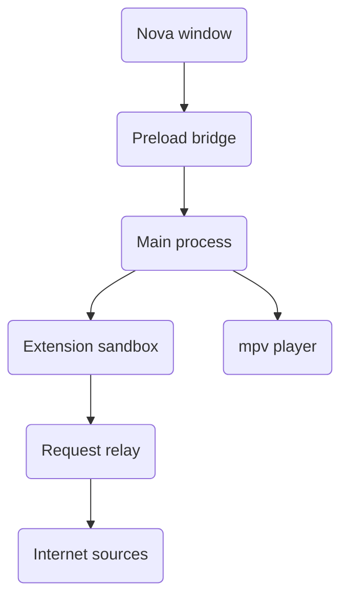

# Vestra

A unified entertainment platform. Anime, movies, TV, YouTube and your own local
media in one place, with a dark, cinematic interface.

Vestra is a monorepo (one folder holding several related apps and shared code):

| App                              | Folder         | Stack                     | Status          |
| -------------------------------- | -------------- | ------------------------- | --------------- |
| **Vestra Nova** — desktop        | `apps/nova`    | Electron 43, React 19     | Working         |
| **Vestra Server** — backend      | `apps/server`  | C# (.NET)                 | Working         |
| **Vestra Pulse** — mobile        | `apps/pulse`   | React Native / Expo       | Early stage     |

**Vestra Server** is the C# backend, with its own provider tests. **Vestra Pulse** is the mobile app, still at an early stage.

## Quick start

You need Node 22 or newer and pnpm 11.

```bash
pnpm install
pnpm dev:nova            # opens the desktop app in development mode
```

To start the built app without development mode:

```bash
pnpm --filter @vestra/nova build
pnpm --filter @vestra/nova start
```

## What Nova does

- **Anime search and details.** Search a title, see its artwork, synopsis and
  episode list, and pick where to watch it from the **Playback source** dropdown.
- **Local files.** Your own video files show up as **Local files** in the same
  dropdown and in the same episode list.
- **Extensions.** Community sources run in a sandbox. A failing source does not
  break the others.
- **Player.** Playback runs in mpv. The gear menu holds subtitles, audio and
  **Quality** choices, and switching quality keeps your place when possible.
- **Loading.** Search results and episode lists are kept for a short time, so
  repeat searches are quick. Failed requests can be retried from the page.

## How the parts connect



The window only talks to the main process through a small, allow-listed
bridge. Extension code never gets direct network access: its requests go
through the main process, which checks them against the host allow-list.

## Structure

```
vestra/
├─ apps/
│  ├─ nova/          Electron desktop app (main, preload, renderer)
│  ├─ server/        C# backend and provider tests
│  └─ pulse/         Mobile app (early stage)
├─ packages/
│  ├─ types/         Shared data shapes (Zod schemas)
│  ├─ config/        Settings, constants, navigation
│  ├─ api/           Outside service clients
│  ├─ providers/     Anime and media source providers
│  ├─ server-providers/  Provider code used by the server
│  ├─ extension-host/    Runs extensions in a sandbox
│  ├─ provider-sdk/  Tools for writing extensions
│  ├─ storage/       Saves data to disk safely
│  ├─ core/          Search, discovery, filename parsing
│  └─ ui/            Shared React components
├─ tests/            Server provider tests
└─ tooling/          Shared TypeScript, ESLint and Tailwind config
```

## Commands

```bash
pnpm dev:nova            # desktop app in development mode
pnpm build               # build everything
pnpm build:server        # build the C# server only
pnpm typecheck           # type-check the workspace
pnpm test:anime          # anime service tests
pnpm test:playback       # playback tests
pnpm test:server         # server provider tests
pnpm format              # format the code
```

Many more `test:*` scripts live in the root `package.json`. The live ones
(`*:live`) contact real websites, so they can fail when a site is down.

## Data

Watchlist, history, progress, settings and the local library index are stored as
JSON files with safe, all-or-nothing writes, so a crash cannot corrupt them.

## Working in this repo

### Branches

`main` is the trunk and is always releasable. Work happens on short-lived
branches prefixed with the app or package they target, for example
`nova/<topic>`, `server/<topic>` or `core/<topic>`.

> **Why not a permanent branch per app?** The `packages/*` folder is shared by
> every app, so long-lived app branches would need every shared change merged
> several times. Keep the work on `main` and use the prefixes for tracking.

### Commits

Conventional Commits, scoped to the package so `git log --grep` stays useful:

```
feat(nova): add quality page to player menu
fix(ui): keep switch knob inside its track
build(deps): pin typescript to 6.x for eslint compatibility
```

Scopes: `nova` `server` `pulse` · `types` `config` `api` `storage` `core` `ui` ·
`eslint` `tsconfig` `tailwind` · `deps` `ci` `release`.

A template is wired up through `commit.template`. Run `git commit` with no `-m`
to see the full list.

### Tags

| Pattern          | Meaning                   |
| ---------------- | ------------------------- |
| `v<x.y.z>`       | Repository-wide milestone |
| `nova-v<x.y.z>`  | Vestra Nova release       |
| `server-v<x.y.z>`| Vestra Server release     |
| `pulse-v<x.y.z>` | Vestra Pulse release      |

Tags are annotated and record what actually shipped, including what did not:
`git tag -n20 nova-v0.1.0`.

## Toolchain

Node 22+, pnpm 11, Turborepo 2, TypeScript 6, Tailwind CSS v4, React 19,
Electron 43, .NET for the server.

> TypeScript is pinned to 6.x. TypeScript 7 (the native rewrite) is released, but
> `typescript-eslint@8` declares `typescript: <6.1.0`, so upgrading breaks lint.
