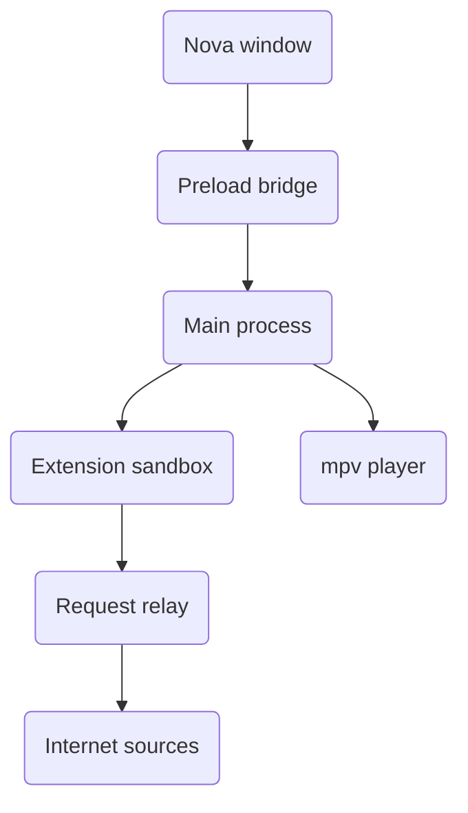

# Vestra

A unified entertainment platform. Anime, movies, TV, YouTube and your own local
media in one place, with a dark, cinematic interface.

Vestra is a monorepo (one folder holding several related apps and shared code):

| App                         | Location                                                     | Stack                 | Status        |
| --------------------------- | ------------------------------------------------------------ | --------------------- | ------------- |
| **Vestra Nova** — desktop   | `apps/nova`                                                  | Electron 43, React 19 | Working       |
| **Vestra Server** — backend | `apps/server`                                                | C# (.NET)             | Working       |
| **Vestra Pulse** — mobile   | [Separate Pulse repository](https://github.com/amabee/Pulse) | Expo planned          | Scaffold only |

**Vestra Nova** stays in this repository with its backend and shared runtime so desktop releases and updater URLs remain unchanged. **Vestra Server** is the C# backend, with its own provider tests. The mobile planning scaffold is now maintained independently in [Vestra Pulse](https://github.com/amabee/Pulse); it is not an implemented mobile app yet. The existing documentation project remains unchanged.

## Quick start

You need Node 22 or newer and pnpm 11.

```bash
pnpm install
pnpm dev:nova            # opens the desktop app in development mode
```

To start the built app without development mode:

```bash
pnpm --filter @vestra/nova build
pnpm --filter @vestra/nova start
```

## Optional Vyla server — try later

Vyla is a separate self-hosted Movies/TV service. Its Nova connector is disabled
until configured; it is not required for other extensions. Live upstream
playback has not yet been verified with this connector.

In one PowerShell terminal, install and start your own server:

```powershell
cd C:\Users\Angelzm\Documents\PROJECTS
git clone https://gitlab.com/vyla-entertainment/stream-api
cd stream-api
npm install

$env:TMDB_API_KEY = 'YOUR_TMDB_V3_API_KEY'
$env:PROXY_STREAMS = 'false'
node server.js
```

Leave that terminal open. Visit <http://127.0.0.1:7860/health> to check the service.
If already cloned, use the existing folder instead of cloning again.

In a second PowerShell terminal, connect Nova:

```powershell
cd C:\Users\Angelzm\Documents\PROJECTS\Vestra
$env:VESTRA_VYLA_URL = 'http://127.0.0.1:7860'
$env:TMDB_API_KEY = 'YOUR_TMDB_V3_API_KEY'
pnpm --filter @vestra/nova build
pnpm --filter @vestra/nova start
```

Use your own key in both terminals. Nova then shows **Vyla · self-hosted** among
Movies/TV sources. Media URLs must be public HTTPS; local HTTP proxy media URLs
are not supported. Clear `VESTRA_VYLA_URL` and restart Nova to disable it.
See the [connector setup and limits](docs/website/vyla.md) and
[upstream hosting instructions](https://vyla.cc/stream-api/deployment/self-hosting.md).

## Nova features

- **Classics without setup.** Install the native
  [Internet Archive source](extensions/internet-archive/README.md) from its folder
  for archival feature films. No account, extra server or TMDb key is required.

- **Anime search and details.** Search a title, see its artwork, synopsis and
  episode list, and pick where to watch it from the **Playback source** dropdown.
- **Local files.** Your own video files show up as **Local files** in the same
  dropdown and in the same episode list.
- **Extensions.** Vestra has its own extension SDK. Existing anime and manga
  provider scripts can be imported through the optional **Compatibility** tab.
  See the [extension direction](docs/extension-direction.md) and
  [authoring guide](packages/extension-host/README.md).
- **Player.** Playback runs in mpv. The gear menu holds subtitles, audio and
  **Quality** choices, and switching quality keeps your place when possible.
- **Loading.** Search results and episode lists are kept for a short time, so
  repeat searches are quick. Failed requests can be retried from the page.

## How the parts connect



The window only talks to the main process through a small, allow-listed
bridge. Extension code never gets direct network access: its requests go
through the main process, which checks them against the host allow-list.

## Structure

```
vestra/
├─ apps/
│  ├─ nova/          Electron desktop app (main, preload, renderer)
│  ├─ server/        C# backend and provider tests
│  └─ docs/          Existing Astro documentation site
├─ packages/
│  ├─ types/         Shared data shapes (Zod schemas)
│  ├─ config/        Settings, constants, navigation
│  ├─ api/           Outside service clients
│  ├─ providers/     Anime and media source providers
│  ├─ server-providers/  Provider code used by the server
│  ├─ extension-host/    Runs extensions in a sandbox
│  ├─ provider-sdk/  Tools for writing extensions
│  ├─ storage/       Saves data to disk safely
│  ├─ core/          Search, discovery, filename parsing
│  └─ ui/            Shared React components
├─ tests/            Server provider tests
└─ tooling/          Shared TypeScript, ESLint and Tailwind config
```

## Commands

```bash
pnpm dev:nova            # desktop app in development mode
pnpm build               # build everything
pnpm build:server        # build the C# server only
pnpm typecheck           # type-check the workspace
pnpm test:anime          # anime service tests
pnpm test:playback       # playback tests
pnpm test:server         # server provider tests
pnpm format              # format the code
```

Many more `test:*` scripts live in the root `package.json`. The live ones
(`*:live`) contact real websites, so they can fail when a site is down.

## Data

Watchlist, history, progress, settings and the local library index are stored as
JSON files with safe, all-or-nothing writes, so a crash cannot corrupt them.

## Working in this repo

### Branches

`main` is the trunk and is always releasable. Work happens on short-lived
branches prefixed with the app or package they target, for example
`nova/<topic>`, `server/<topic>` or `core/<topic>`.

> **Why not a permanent branch per app?** The `packages/*` folder is shared by
> every app, so long-lived app branches would need every shared change merged
> several times. Keep the work on `main` and use the prefixes for tracking.

### Commits

Conventional Commits, scoped to the package so `git log --grep` stays useful:

```
feat(nova): add quality page to player menu
fix(ui): keep switch knob inside its track
build(deps): pin typescript to 6.x for eslint compatibility
```

Scopes: `nova` `server` · `types` `config` `api` `storage` `core` `ui` ·
`eslint` `tsconfig` `tailwind` · `deps` `ci` `release`.

A template is wired up through `commit.template`. Run `git commit` with no `-m`
to see the full list.

### Tags

| Pattern           | Meaning                                                                                               |
| ----------------- | ----------------------------------------------------------------------------------------------------- |
| `v<x.y.z>`        | Repository-wide milestone                                                                             |
| `nova-v<x.y.z>`   | Vestra Nova release                                                                                   |
| `server-v<x.y.z>` | Vestra Server release                                                                                 |
| `pulse-v<x.y.z>`  | Pulse releases belong in [Pulse](https://github.com/amabee/Pulse); historical tags here are preserved |

Tags are annotated and record what actually shipped, including what did not:
`git tag -n20 nova-v0.1.0`.

## Toolchain

Node 22+, pnpm 11, Turborepo 2, TypeScript 6, Tailwind CSS v4, React 19,
Electron 43, .NET for the server.

> TypeScript is pinned to 6.x. TypeScript 7 (the native rewrite) is released, but
> `typescript-eslint@8` declares `typescript: <6.1.0`, so upgrading breaks lint.

### Configure TMDb in Nova

Open **Settings → Connections → TMDb connection** and enter your own **API Read Access Token** (recommended) or **v3 API key** from [TMDb account settings](https://www.themoviedb.org/settings/api). Save the connection; catalogue configuration updates immediately, without restarting. Saving does not validate the credential against TMDb.

Nova encrypts the saved credential using the operating system's secure storage, separately from ordinary settings. It is never returned by the settings status API or passed into extension isolates. Saved credentials override environment configuration. **Remove saved credentials** restores `TMDB_ACCESS_TOKEN` / `TMDB_API_KEY` from the environment, if present. Hosts without secure storage can keep using environment variables.

New source research: [Nuvio provider review](docs/nuvio-provider-review.md).

### Bundled native source ports

A rebuilt Nova lists MovieBox, KissKH, Internet Archive, VixSrc, StreamFlix, Vidlink and DesiFlix in **Extensions → Available**, including without a configured registry. Install/review is optional and uses the existing sandbox permissions. StreamFlix and Vidlink are **experimental**: their upstream playback endpoints currently fail live checks. StreamFlix installation is held pending verification and a sandbox cleanup fix. See the [port review and availability notes](docs/nuvio-provider-review.md). VixSrc and Vidlink use your TMDb connection from Settings; StreamFlix currently supports Movies only.

[DesiFlix](extensions/desiflix/README.md) supports native Movies/Series playback with no extra key/server; movie and TV samples passed native-player verification. It currently offers title search, with availability checked on Play. Audio languages and embedded subtitle tracks vary by title.

### App updates

Installed Windows builds check for stable app updates automatically. **Settings → Updates** provides manual checking, download progress, release notes and **Restart and install**. Source runs do not self-update. See the [release guide](docs/app-updates.md) for patch/minor/major version bumps, draft releases and validation.

### App and interface settings

Settings opens to **User Interface**: theme, accent color, text size, navigation labels, glass effects and reduced motion. **App** controls the next launch destination and status bar. Changes persist on this computer.

**Settings → Diagnostics** shows source runtime availability and recent playback failures, with a redacted copyable report. **Settings → Torrents** configures your own qBittorrent Web UI; **Downloads** lists and controls only the chosen category. This does not install a torrent client or provide an embedded torrent-streaming engine. See the [settings and torrent setup guide](docs/settings-and-source-health.md).

## Extension development

[**Vestra Foundry**](https://github.com/amabee/Foundry) owns the native extension sources and registry. The SDK and sandbox remain here. New profiles use `https://raw.githubusercontent.com/amabee/Foundry/main/extensions/registry.json`; the former Vestra registry path remains a compatibility mirror for older clients. Updated clients fetch Foundry for that saved official URL while retaining its stored origin; custom URLs and empty registry lists are unchanged.

`extensions/` is a pinned offline snapshot, verified against SHA-256 entries in `extensions.snapshot.json`. Do source development in Foundry. After reviewing a Foundry commit, run `pnpm extensions:update <full-commit-sha>`, review the source/lock diff, and run `pnpm test:foundry` and SDK tests. `pnpm extensions:verify` works offline; `pnpm extensions:sync` restores the already-pinned upstream files when the snapshot is clean. Packaging refuses unreviewed snapshot drift. Existing installed extension IDs, permission grants and custom registries are retained.
